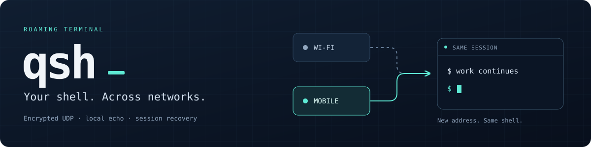
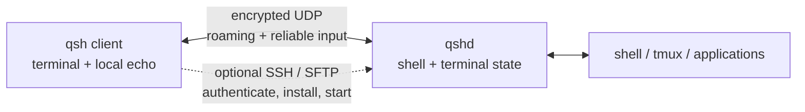

<p align="center">
  
</p>

<p align="center">
  <a href="LICENSE"></a>
  
  
</p>

<p align="center">
  <a href="#quick-start">Quick start</a> ·
  <a href="#installing">Install</a> ·
  <a href="docs/cli-guide.md">CLI guide</a> ·
  <a href="docs/protocol.md">Protocol</a> ·
  <a href="#building-and-ci">Build</a> ·
  <a href="#contributing-and-contact">Contribute</a>
</p>

**qsh is a remote terminal that keeps the same shell when your network changes.**
Move between Wi-Fi and mobile data, close your laptop, or reconnect after an
outage. The client and daemon share terminal state over an encrypted UDP
transport, with local input prediction for responsive typing.

| Keep working | How qsh helps |
| --- | --- |
| Change networks | A cryptographic session identity follows the connection to its new address. |
| Type over a slow link | Local echo predicts input and reconciles it with the server's output. |
| Reach a host by several routes | Supply multiple addresses; qsh monitors paths and can move the session between them. |
| Recover after an outage | UDP recovery runs independently of SSH startup attempts and their backoff. |
| Start on a new server | With SSH enabled, approve installation of a missing `qshd` from a matching GitHub release. |

qsh complements **tmux**. It keeps the transport usable; tmux supplies longer-lived
sessions and workspace management. The console client opens a regular shell,
where you can run tmux, Claude Code, opencode, or other terminal applications.

> [!NOTE]
> This README describes `main`. A released binary follows its own version's
> documentation. Automatic daemon installation requires a published release
> matching the client's exact version.

## Provenance and disclaimer

qsh was written predominantly by large language models, directed and
reviewed by its author. Every change passes the project's test suite and a
review pass before it lands, but neither makes machine-written code
trustworthy by default. The software may contain defects, including ones
that affect the confidentiality or integrity of the sessions it carries.
Use it at your own risk, and audit it yourself before you trust it with
anything that matters.

This states in plain words what sections 15 and 16 of the AGPL already say:
the program comes with no warranty of any kind, and the copyright holder is
not liable for any damages arising from its use.


## Quick start

Install the client from [GitHub Releases](https://github.com/br0adcast/qsh/releases),
then connect to a host where `qshd` is already running:

```sh
qsh user@server.example.org
```

Or enable SSH to find and start the daemon, offering installation if it is missing:

```sh
qsh user@server.example.org,ssh
```

Review host-key fingerprints and the installation prompt before accepting them.
SSH uses port 22 by default; `,ssh=2222` selects another port. The terminal itself
uses UDP, normally port **60022**; the server firewall must allow it.

Useful first commands:

```sh
# Several routes to the same server
qsh user@home.example.org,ssh 10.8.0.1,ssh

# A specific identity and SSH port
qsh -i ~/.ssh/id_ed25519 user@server.example.org,ssh=2222

# Start a personal daemon manually on the server
qshd serve
```

| While connected | Action |
| --- | --- |
| `Ctrl-] ?` | Show help. |
| `Ctrl-] s` | Show routes and connection state. |
| `Ctrl-] [` | Browse the client's scrollback history. |
| `Ctrl-] r` | Reconnect now; during recovery, remove the SSH retry delay. |
| `Ctrl-] .` | Leave the client and retain the server session. |
| `Ctrl-] Ctrl-]` | Send a literal `Ctrl-]` to the remote application. |

See the [CLI guide](docs/cli-guide.md) for authentication, port knocking, all
options, recovery behavior, logging, and exit codes.

## Installing

Download packages or archives and `SHA256SUMS` from the
[releases page](https://github.com/br0adcast/qsh/releases).

| Platform | Architectures | Downloads |
| --- | --- | --- |
| Linux | x86_64, aarch64 | `.tar.gz` containing `qsh` and personal-mode `qshd`; separate client and daemon `.deb` / `.rpm` packages. |
| macOS | Apple Silicon, Intel | `.tar.gz` containing `qsh` and personal-mode `qshd`. |

On Linux, the portable binaries use static musl builds. The packaged system-mode
`qshd` instead links glibc and PAM and has a minimum supported system version.
macOS builds target Darwin and use macOS system libraries; they are not musl
binaries. Windows packages are not currently produced.

<details>
<summary><strong>Package and archive installation examples</strong></summary>

Replace `0.5.0` with the version you downloaded. On Linux ARM64, use `_arm64.deb`,
`.aarch64.rpm`, or the `aarch64-unknown-linux-musl` archive.

```sh
# Debian / Ubuntu: the client; install qshd separately if this is a server
sudo apt install ./qsh_0.5.0-1_amd64.deb
sudo apt install ./qshd_0.5.0-1_amd64.deb

# Fedora / RHEL
sudo dnf install ./qsh-0.5.0-1.x86_64.rpm
sudo dnf install ./qshd-0.5.0-1.x86_64.rpm

# Portable Linux binaries, personal daemon mode
tar xzf qsh-0.5.0-x86_64-unknown-linux-musl.tar.gz
sudo install -m755 qsh-0.5.0-*/qsh qsh-0.5.0-*/qshd /usr/local/bin/

# macOS Apple Silicon; use x86_64-apple-darwin on Intel
tar xzf qsh-0.5.0-aarch64-apple-darwin.tar.gz
sudo install -m755 qsh-0.5.0-*/qsh qsh-0.5.0-*/qshd /usr/local/bin/
```

The client package does not depend on the daemon package, or vice versa. The
server package supports a shared system service with account lookup and PAM;
portable archives contain the personal-mode daemon. The Fedora/RHEL PAM stack
shipped in the server RPM is not suitable for openSUSE without adjustment.
See the [service guide](docs/qshd-service.md) for platform requirements.

</details>

Verify downloads against the checksums from the same release:

```sh
# Linux
sha256sum --ignore-missing -c SHA256SUMS

# macOS
shasum -a 256 --ignore-missing -c SHA256SUMS
```

### Installing a missing daemon over SSH

For an interactive `,ssh` connection, qsh can download its **exact release
version**, verify SHA-256, and transfer the daemon over SFTP. It verifies the
uploaded file before atomically publishing it in the remote user's cache.
A verified local cache avoids repeated archive downloads; each installation
still attempts a release metadata check. See the [installation guide](docs/cli-guide.md#ssh-startup-and-installation)
for network waits and offline cache limits.

Installation requires your confirmation. It does not use `sudo`, replace a
system service, or automatically upgrade an existing daemon. Background recovery
never prompts, downloads, or installs. If the matching release is unavailable,
install the daemon manually. Details: [SSH startup and installation](docs/cli-guide.md#ssh-startup-and-installation).

## How it works



The session belongs to a cryptographic identity, not a fixed client address.
A change of network can therefore keep the same shell and screen. Reliable
input is retransmitted while the connection remains recoverable. After a long
outage, the server repaints its current screen instead of retaining unlimited
output; lines produced while away may be lost.

A completely silent session stays alive for a day, followed by a further hour
of retained backend state for warm reconnection. The daemon keeps at most sixteen
live and retained sessions together. This is not indefinite persistence: use
tmux when you need a workspace to outlive these limits or a daemon restart.
See [recovery and session limits](docs/cli-guide.md#recovery-and-session-limits).

## Security and trust

- **Encrypted transport:** `Noise_IK_25519_ChaChaPoly_BLAKE2s` with X25519,
  ChaCha20-Poly1305, and BLAKE2s.
- **Account authentication:** SSH key signatures, or authorization established
  by a successful SSH login. System mode also checks the named account through PAM.
- **Host identity:** first-use fingerprints require confirmation; changed keys
  are rejected. SSH host keys and qsh daemon keys are separate trust stores.
- **Limits:** encryption does not hide addresses, traffic volume, or timing, and
  cannot protect a compromised client or server. Verify initial fingerprints
  out of band when necessary.

Read the [trust model](docs/cli-guide.md#authentication-and-host-trust) and
[protocol specification](docs/protocol.md) before relying on these guarantees.


## Building and CI

Rust **1.98.1** is the minimum supported version for every workspace member;
`rust-toolchain.toml` selects it with rustfmt and Clippy. This is an intentional
support floor, not the oldest compiler that might compile the code. CI covers
it in the existing Linux container and portable macOS jobs, while ordinary
Linux quality/runtime checks use 1.99.1. Follow the ordered
[contributor setup](CONTRIBUTING.md#rust-and-native-setup). The source support
floor does not widen the exact compiler qualification for
[terminal resource bounds](docs/terminal-resources.md).

Prepare the verified static OpenSSL prefix described in the
[native build prerequisites](docs/native-crypto.md), then build both binaries
from source with Rust:

```sh
cargo build --release --locked -p qsh -p qshd
```

For local integration tests, install OpenSSH server (`/usr/sbin/sshd` on Linux),
OpenSSH client tools and binutils. Linux builds with `qshd/system` also need
PAM development libraries. The workflows record the build and packaging commands:

| Workflow | Trigger | What it does |
| --- | --- | --- |
| [CI](.github/workflows/ci.yml) | Push to `main`, pull request | Formatting, Clippy, unit/doc/integration tests, and isolated privileged system-mode tests. |
| [Release](.github/workflows/release.yml) | Version tag `v*.*.*` or manual dispatch | Linux and macOS builds, `.deb` / `.rpm` packaging, server-package acceptance checks, and `SHA256SUMS`. |

Release builds cover Linux x86_64/aarch64 and macOS Intel/Apple Silicon. The release
job waits for build and package-acceptance jobs. A manual run on a branch produces
artifacts; publishing a GitHub Release occurs only for a tag. The tag version must
match the Cargo workspace version. These links describe the configured workflows,
not the status of any particular run.

## Documentation and core layout

| Read | For |
| --- | --- |
| [CLI guide](docs/cli-guide.md) | Connections, keyboard controls, history, recovery, diagnostics, and options. |
| [Daemon service guide](docs/qshd-service.md) | Personal and system services, systemd/launchd, PAM, and platform limits. |
| [Protocol](docs/protocol.md) | Wire format, handshake, sessions, channels, roaming, and threat model. |
| [Changelog](CHANGELOG.md) | Version-by-version changes. |
| [Privacy check](docs/private-data-check.md) | Local secret scanning and manual review before publishing. |

<details>
<summary><strong>Explore the Rust workspace</strong></summary>

| Crate | Responsibility |
| --- | --- |
| `crates/transport` | Noise encryption, reliable streams, channels, roaming, and multipath. |
| `crates/terminal` | VT screen model using `alacritty_terminal`. |
| `crates/prediction` | Local input prediction. |
| `crates/client` | Platform-independent client logic. |
| `crates/render` | Rendering frames into terminal control sequences. |
| `crates/sshauth` | Authentication through SSH key signatures. |
| `crates/ssh` | SSH authentication, host-key checks, exec, and SFTP through `russh`. |
| `crates/knock` | Port knocking before SSH. |
| `crates/bringup` | Daemon discovery, approved installation, and startup over SSH. |
| `crates/connect` | Address selection and retry scheduling without I/O. |
| `crates/logging` | Shared log format, filtering, and rotating file output. |
| `qshd` / `cli` | The daemon and console client. |

</details>

## Contributing and contact

Patches, ideas, bug reports, and plain questions are all welcome. Open an
[issue](https://github.com/br0adcast/qsh/issues), or read
[CONTRIBUTING.md](CONTRIBUTING.md) before submitting a pull request; it describes
the licensing condition for contributions.

Financial support is welcome too: donations pay for the model tokens used in
development. See [Supporting the project](#supporting-the-project) for addresses.

For other questions and commercial licensing, contact the maintainer through
[GitHub](https://github.com/br0adcast).

## License

Copyright (C) 2026 br0adcast.

qsh is available under the [GNU Affero General Public License v3](LICENSE).
The copyright holder also offers separate commercial licenses for closed-source
products. See [CONTRIBUTING.md](CONTRIBUTING.md) for contribution terms.

## Supporting the project

Donations are entirely voluntary and buy no influence over the project.
They go towards the model tokens the development runs on.

| Network | Address | Accepted |
| --- | --- | --- |
| Bitcoin | `18X7UsTVEGonjHPGVyevJU96jARrBagK37` | BTC |
| EVM: Ethereum, Polygon, BNB Chain, Arbitrum, Optimism, Base | `0x56733ab43bB3BB1e6F95A7c1b39169ED7B51f59A` | USDT, USDC, ETH and the network's own coin |
| TRON (TRC20) | `TUcbET5oq94czC8NuhR3FAev877PxnmRGP` | USDT, TRX |
| TON | `UQAAY_8tn4pEUGTFFEnT6M46OJCLD9783saMDxSiI6rBB9rm` | TON, USDT |
| Solana | `7Ci6wb1HyHexdXYqhNZEEfNqmCvkgpJYJGTUKtuFjFk2` | USDC, SOL |

The EVM row is a single address that is valid on every network listed
beside it — pick whichever costs you least. Please send only on the
networks named here: anything else is likely to be lost, and nobody can
recover it for you.
